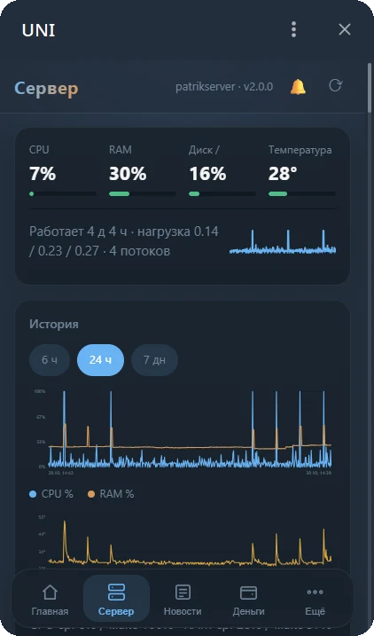
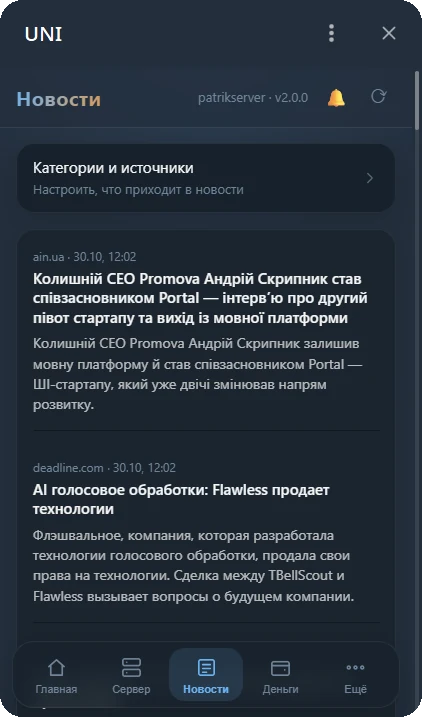
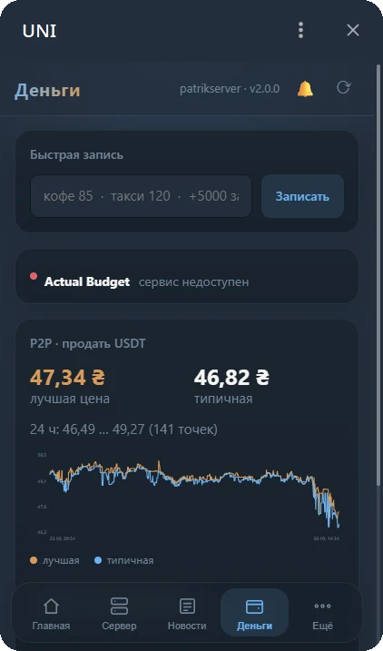
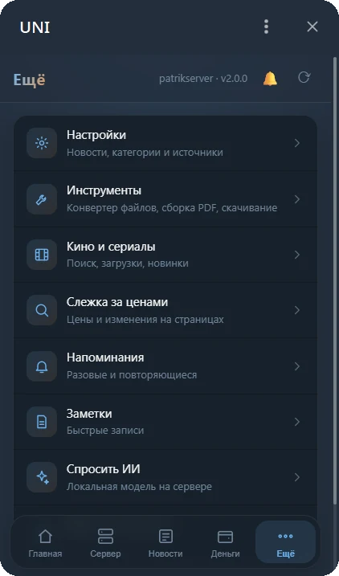

<div align="center">


**Ваш домашний сервер в Telegram.** Приложения, мониторинг, новости и ремонт сервера: в чате и в красивом мини-приложении.

[Сайт](https://vkardin.github.io/uni-homebot/) · [Скачать](https://github.com/vkardin/uni-homebot/releases/latest) · [Установка](#установка-за-минуту)

   

   

</div>

> **English:** UNI is a Telegram bot and Mini App panel for your home server, like Homarr but inside Telegram.
> Install with `sudo bash homebot/deploy/install.sh` (or `--docker`), then set `LANGUAGE=en` or pick
> English in the panel (More → Settings). Menus, commands and the main panel screens are translated;
> the rest is still Russian and is being translated step by step. See [CONTRIBUTING.md](CONTRIBUTING.md).

## Что такое UNI

Как Homarr, только в Telegram. У каждого свой бот на своём сервере:

* 🚀 **Доска приложений**: Jellyfin, Radarr, Sonarr, qBittorrent, AdGuard и ваши ссылки одной сеткой.
* 🧩 **Подключение из чата**: бот сам находит контейнеры, достаёт ключи и проверяет связь. Каталог ставит новые приложения в один тап.
* 🧱 **Модули**: любую часть можно выключить, не потеряв настройки.
* 🩹 **Самовосстановление**: упавшие задачи перезапускаются сами, опечатка в `.env` не роняет бота, в /doctor есть кнопка «🔧 Починить».
* 🛠 **Ремонт сервера по PIN**: перезапуск служб и бота, перезагрузка. Выключен по умолчанию, у каждого действия есть журнал.
* 🔔 **Центр уведомлений**, 📖 режим чтения новостей, 🌙 тихие часы, 👥 гости с правами по разделам.
* ✨ **Мини-приложение** в светлой и тёмной теме Telegram: всё, что есть в чате, есть и в панели.

### Установка за минуту

```bash
tar xzf homebot-7.1.0.tar.gz      # архив со страницы релизов
sudo bash homebot/deploy/install.sh
```

Скрипт спросит только токен бота. Владельцем станет тот, кто первым отправит боту `/start КОД`: код появится в журнале сервера.
Нужен Docker? Есть `deploy/install.sh --docker`. Обновления приходят прямо из чата: просто отправьте боту архив релиза.

---

## Подробно

> **Главное:** каждый час UNI обновляет сводку: погода и курс → до 5 **новых** новостей за час, пересказанных
> локальной моделью Ollama по-русски → состояние сервера. По умолчанию это одно сообщение на день, которое
> тихо обновляется каждый час (утром — новое, с уведомлением). Частота, количество, тихие часы и источники
> настраиваются прямо в боте: ⚙️ Настройки. Ниже — всё остальное, что умеет бот.

### Как работают новости

* Бот запоминает каждую увиденную новость (SQLite) и никогда не присылает её повторно.
* Берутся только опубликованные с прошлой рассылки. При первом знакомстве с лентой её архив
  запоминается, но не присылается.
* Дубли из разных лент убираются, источники чередуются, свежие — первыми.
* Пересказ — один запрос к Ollama на всю пачку, строго по JSON-схеме. Если у новости нет описания,
  бот читает начало статьи, чтобы модели не пришлось додумывать.
* В тихие часы рассылки нет; первая утренняя покажет главное за ночь.
* «⚡ Свежие сейчас» в разделе 🗞 Новости — собрать без ожидания.

---

Асинхронный бот на **aiogram 3** (Python 3.11+): мониторинг сервера через `psutil`, inline-пульт,
интеграция с локальной **Ollama**, новости с пересказом и ежечасная сводка (погода, курсы, состояние сервера), доступ строго по `ADMIN_ID`.
Запускается как демон **systemd**.

## Возможности

| Раздел | Команда | Что делает |
|---|---|---|
| Состояние | `/status` | CPU, load average, RAM, swap, температура, накопители, аптайм; кнопка «Обновить», «Топ процессов» |
| Службы | `/services` | Статус systemd-юнитов из `MONITORED_SERVICES` (через `systemctl show`, root не нужен) |
| Задачи | `/tasks` | Включение/выключение фоновых задач кнопками: **Алерты** (CPU/RAM/диски/температура/упавшие службы), новости, P2P-курс и другие проверки. Выбор запоминается и переживает перезапуск |
| Ollama | `/ollama` | Статус и загруженные модели, **чат с потоковым ответом**, **резюме текста, ссылки или PDF**, смена модели, **«🧹 Выгрузить из RAM»** (`keep_alive: 0`) |
| Новости и сводка | `/news` | Каждый час: погода и курс, свежие новости с пересказом (источники, тихие часы и количество — кнопками), состояние сервера, обновления и SMART |
| Live | кнопка «📡 Live» | Одно сообщение обновляется каждые 5 с в течение 3 минут |
| Графики | `/charts` | CPU, RAM, температура, диск за 6 ч / 24 ч / 7 дней (история в SQLite, хранится 30 дней) |
| Журналы | `/logs` | Последние строки журнала любой службы из списка + «🧠 Объяснить» моделью |
| Сеть | `/net` | Устройства Tailscale (онлайн/офлайн, exit-node), внешний IP, текущая скорость |
| Безопасность | `/security` | Последние SSH-входы, неудачные попытки за сутки, обновления apt, перезагрузка, SMART дисков |
| Управление | `/power` | Перезапуск служб из `RESTART_SERVICES`, перезагрузка/выключение (если `POWER_ENABLED=true`) — с подтверждением на 60 с |
| Напоминания | `/remind`, `/reminders` | «через 30 минут…», «завтра 9:00…», «в пятницу 19:00…», «15.10 10:00…» |
| Заметки | `/note`, `/notes` | Быстрые заметки с удалением кнопкой |
| Фоновые уведомления | `/tasks` | SSH-входы сразу, неудачные попытки сводкой, проблемы SMART, обновления безопасности, ошибки диска и OOM из журнала ядра |
| Приложения | `/apps`, `/docker`, `/speed`, `/torrents`, `/adguard`, `/jellyfin` | Docker (статус, журнал, разбор, перезапуск), Speedtest Tracker (замер, график 7 дней), qBittorrent (загрузки, пауза), AdGuard (статистика, пауза защиты на 10 мин), Jellyfin (кто смотрит, новинки) |
| Чистка диска | `/cleanup` | Просмотренное в Jellyfin → удалить через Radarr/Sonarr (с подтверждением), прогноз «диск заполнится через N дней» |
| Финансы | `/money`, `/spend`, `/actual`, просто «кофе 85» | Actual Budget в простом виде: балансы, расход месяца, бюджет по категориям, операции с удалением, запись трат и доходов с «↩️ Отменить» |
| P2P-курс | `/p2p` | Binance P2P: за сколько сейчас продаётся USDT за гривну, график 7 дней, уведомления о резком изменении, о достижении вашей цены и вечерний итог |
| Сайты | `/sites` | Пульт для changedetection.io: список слежек с ценами, добавление по ссылке (цена товара или любые изменения), пауза, проверка сразу, частота, удаление; уведомления «цена было→стало», «что изменилось» |
| Прочее | `/menu`, `/cancel` | Главное меню; выход из режима чата/резюме |

## Структура проекта

```
homebot/
├── homebot/
│   ├── main.py            # точка входа: сборка сервисов, polling, graceful shutdown
│   ├── app.py             # Dispatcher: middleware, роутеры, startup/shutdown-хуки
│   ├── config.py          # Settings (pydantic-settings), валидация .env
│   ├── states.py          # FSM-состояния (чат / резюме)
│   ├── middlewares/       # AdminOnlyMiddleware — доступ только по ADMIN_ID
│   ├── handlers/          # тонкий слой: common, monitoring, news, movies, finance, p2p, tasks, ollama, errors, fallback
│   ├── services/          # вся логика без привязки к Telegram:
│   │                      #   system (psutil), units (systemd), ollama, digest (часовая сводка), brief, news, feeds, weather,
│   │                      #   tasks (менеджер фоновых задач), state (JSON-хранилище)
│   ├── jobs/              # фоновые задачи: alerts, news, p2p_watch, apps_watch, …
│   ├── web/               # 🖥 веб-панель: api.py (JSON), auth.py (подпись Telegram), static/ (страница без сборки)
│   ├── ui/                # callbacks (CallbackData), keyboards, texts (HTML-экраны)
│   └── utils/             # formatting, timing, telegram-хелперы
├── deploy/homebot.service # unit-файл systemd (с усилением изоляции)
├── tests/                 # pytest (без плагинов)
├── .env.example
└── requirements.txt
```

Принцип: **handlers** только принимают событие, зовут **service** и рисуют ответ через **ui**.
Сервисы ничего не знают об aiogram, поэтому тестируются без Telegram. Зависимости попадают в
обработчики через DI aiogram (`workflow_data`): достаточно объявить параметр `ollama: OllamaService`.

## Установка на сервер

Одной командой из распакованного архива:

```bash
tar xzf homebot-X.Y.Z.tar.gz && sudo bash homebot/deploy/install.sh
```

`install.sh` сам определяет пакетный менеджер (apt, dnf, pacman, apk), ставит Python 3.11+ с venv, rsync, curl,
спрашивает токен бота (проверяет его в Telegram) и ваш Telegram ID, пишет `/opt/homebot/.env` (права 600)
и дальше запускает обычный `deploy/update.sh`: зависимости, инструменты конвертера, systemd-служба.
Если Tailscale уже стоит, при первой установке включается `tailscale serve` для панели и прописывается `WEB_URL`.

* Без вопросов: `sudo BOT_TOKEN=... ADMIN_ID=... bash homebot/deploy/install.sh`.
* Если бот уже установлен (в `.env` есть токен), скрипт ничего не спрашивает и просто обновляет, `.env` не трогает.
* Нужен systemd. На Ubuntu/Debian проверено полностью; Fedora, Arch — та же логика с их именами пакетов
  (в Fedora ffmpeg ставится как `ffmpeg-free`). На старом Python (например, Ubuntu 22.04 с 3.10) скрипт
  остановится и предложит Docker.

### 🐳 Docker

Для систем без systemd (Alpine и др.) или если не хочется ставить пакеты в систему:

```bash
tar xzf homebot-X.Y.Z.tar.gz && cd homebot && sudo bash deploy/install.sh --docker
```

Скрипт спросит токен и ID, запишет `.env` рядом с `compose.yml` и выполнит `docker compose up -d --build`.
Если `.env` уже готов, хватит `docker compose up -d --build`. Журнал: `docker logs -f homebot`.

* Бот работает в сети хоста (`network_mode: host`): адреса из `.env` (`127.0.0.1:8088` для панели, прокси Docker,
  локальные Radarr/Sonarr/Ollama) те же, что и при обычной установке. Данные — в томе `homebot-data` (`/data`).
* Вместе с ботом поднимается прокси Docker только на чтение (`homebot-docker-proxy`, 127.0.0.1:2375).
* В контейнере нет systemd: слежка за SSH-входами, перезапуск служб, питание, SMART и обновление архивом из чата
  недоступны. Обновление — распаковать новый архив поверх и снова `sudo bash deploy/install.sh --docker`.
* «Сервер» показывает процессы контейнера; чтобы видеть процессы хоста, раскомментируйте `pid: host` в `compose.yml`.
* LibreOffice в образ не входит (~400 МБ): `docker compose build --build-arg OFFICE=1`.
* На Alpine для скрипта нужен bash: `apk add bash docker docker-cli-compose`.

### Вручную

Нужен **Python 3.11+**.

```bash
# 1. Системный пользователь и каталог
sudo useradd --system --home /opt/homebot --shell /usr/sbin/nologin homebot

# 2. Код (с вашего компьютера по Tailscale; подставьте имя хоста)
rsync -av --exclude .venv --exclude data --exclude __pycache__ ./homebot/ user@server:/tmp/homebot-src/
ssh user@server 'sudo mkdir -p /opt/homebot && sudo rsync -a /tmp/homebot-src/ /opt/homebot/ && sudo chown -R homebot:homebot /opt/homebot'

# 3. Виртуальное окружение и зависимости (на сервере)
sudo -u homebot python3 -m venv /opt/homebot/.venv
sudo -u homebot /opt/homebot/.venv/bin/pip install -r /opt/homebot/requirements.txt

# 4. Конфигурация
sudo -u homebot cp /opt/homebot/.env.example /opt/homebot/.env
sudo -u homebot nano /opt/homebot/.env      # BOT_TOKEN и ADMIN_ID обязательны
sudo chmod 600 /opt/homebot/.env

# 5. Служба
sudo cp /opt/homebot/deploy/homebot.service /etc/systemd/system/homebot.service
sudo systemctl daemon-reload
sudo systemctl enable --now homebot
journalctl -u homebot -f
```

* `BOT_TOKEN` — от @BotFather, `ADMIN_ID` — ваш числовой ID (например, через @userinfobot).
* **Остановите старого бота** перед запуском нового: два процесса с одним токеном дают
  `TelegramConflictError`.
* При ошибке конфигурации (нет токена, неверный формат) бот печатает список проблем и завершается
  с кодом **78**; systemd в этом случае **не** перезапускает его в цикле (`RestartPreventExitStatus=78`).
  То же при отклонённом токене.
* После перезагрузки сервера бот ждёт сеть и Tailscale (повторы с нарастающей паузой), а не падает.

Обновление: скопировать новый код, `pip install -r requirements.txt`, `sudo systemctl restart homebot`.

## Обновление (одной командой)

Положите новый архив (`homebot-<версия>.tar.gz`, версия в имени — чтобы не путать) в любую папку на сервере, например `~/homebot-releases/`, и выполните:

```bash
cd ~/homebot-releases && tar xzf homebot-X.Y.Z.tar.gz && sudo bash homebot/deploy/update.sh --test
```

`update.sh` идемпотентен: копирует код в `/opt/homebot` (не трогая `.env`, `.venv` и данные), ставит
зависимости, **дописывает в `.env` только новые параметры** со значениями по умолчанию, ставит
`smartmontools` и root-таймер SMART-снимков, пишет polkit-правило для перезапуска служб/питания,
обновляет unit-файл и перезапускает бота. С `--test` сначала прогоняет тесты: если они упадут,
бот **не** перезапускается и продолжает работать старая версия.

После изменения `RESTART_SERVICES` или `POWER_ENABLED` в `.env` снова запустите
`sudo bash /opt/homebot/deploy/update.sh` — он перегенерирует права polkit.

### 🆕 Обновления с GitHub и подпись (7.1)

* Раз в сутки бот смотрит релизы `UPDATE_REPO` (по умолчанию `vkardin/uni-homebot`) и один раз сообщает о
  новой версии. «⬇️ Скачать и проверить» скачивает архив (и `.sig`, если есть) и показывает обычную карточку
  с «✅ Установить». `UPDATE_CHANNEL=stable` (по умолчанию) — обычные релизы, `beta` — и тестовые, `off` —
  не проверять. В Docker проверка выключена (обновление там — новым образом).
* **Подпись**: Ed25519 над sha256 архива, файл `homebot-X.Y.Z.tar.gz.sig`. Ключ автора создаётся
  `python tools/sign_release.py keygen` (секретный остаётся в `~/.config/uni/release.key`), открытый
  добавляется строкой в `homebot/release_keys.txt`. Архив присылайте как раньше, а `.sig` — следом отдельным
  файлом. Подпись не сходится — установка запрещена; `UPDATE_REQUIRE_SIGNATURE=true` запрещает и архивы без подписи.
* Тег `vX.Y.Z` в GitHub собирает архив, подписывает его (если задан секрет `RELEASE_KEY` — base64 файла ключа)
  и публикует релиз (`.github/workflows/release.yml`).
* Новая зависимость `cryptography`: обновлятор ставит её сам. Системные файлы (`deploy/`) не менялись.

### 🌐 UNI 7.0: языки и открытый проект

* **Языки ru, en, uk.** `LANGUAGE=en` в `.env` или «Язык» в панели (Ещё → Настройки → Общие), после
  перезапуска. Переведены главное меню, подсказки команд, «Начало работы» и основные экраны панели;
  непереведённое остаётся по-русски (перевод по исходной строке: `homebot/i18n.py`, `TR` в `app.js`).
  На существующих установках ничего не меняется: по умолчанию `ru`.
* **Лицензия MIT** (`LICENSE`), **проверки на каждый коммит** в GitHub Actions: ruff, тесты на Python
  3.11–3.13, проверка синтаксиса панели (`.github/workflows/ci.yml`).
* **Для новых участников**: `CONTRIBUTING.md` и короткое описание на английском в начале README.

### 🧪 Стабилизация (6.6)

Итог ветки 6.x: «Начало работы», настройки из панели, разделы-модули, доска 2.0 и перенос проверены на
запущенном боте в браузере; новые разделы панели закрыты для гостей. Формат `state.json`, `.env` и
systemd-юниты за всю ветку 6.1–6.6 не менялись: добавились только `settings.json` и новые ключи.

### 📦 Перенос и бэкап перед обновлением (6.5)

`/export` присылает `uni-settings.json`: настройки из панели, новости и источники, ночной режим, P2P, доска
приложений, выключенные модули. На новом сервере отправьте этот файл боту и нажмите «Применить» (перед этим
бот сохранит бэкап). Токены, ключи приложений, люди и данные (заметки, напоминания, история) в файл не входят:
для них есть бэкап. Перед обновлением из чата бот теперь сам делает бэкап, а `settings.json` попадает в каждый
бэкап и восстанавливается вместе с базой. Откат кода по-прежнему — «↩️ Откатить» после обновления.

### 🟢 Доска приложений 2.0 (6.4)

На каждой плитке доски точка: зелёная — приложение отвечает, красная — нет. Проверяет сам бот по внутреннему
адресу, не чаще раза в минуту (`GET /api/launcher/status`). Свои ссылки получили группы и порядок: долгое
нажатие открывает меню «Левее / Правее / Группа / Убрать». Группа хранится в поле `group` у ссылки в
`launcher_links` (`state.json`); старые ссылки без группы остаются в общей сетке.

### 🧱 Разделы как модули (6.3)

В «Модулях» (чат: 🧩 Приложения → Модули, панель: Ещё → Настройки) теперь не только подключённые приложения,
но и встроенные разделы: 🗞 Новости, 🤖 Ассистент, ⏰ Напоминания, 📝 Заметки, 🧰 Инструменты,
☔ Погодные предупреждения и 🎮 Бесплатные игры. Выключенный раздел пропадает из главного меню, подсказок
команд и панели, а его фоновые задачи не запускаются (после перезапуска). Список хранится там же, в
`modules_off` в `state.json`: id разделов не совпадают с id плиток, поэтому список из 6.0 читается без миграции.

### ⚙️ Настройки из панели (6.2)

В панели «Ещё → Настройки» появились общие настройки: часовой пояс, валюта, координаты и название места для
погоды, курсы в сводке, регион магазинов игр, пороги алертов, час бэкапа и число копий. Значения хранятся в
`STATE_DIR/settings.json` (права 600) и применяются при запуске, поэтому после сохранения панель предлагает
перезапустить бота. **`.env` главнее**: заданное там панель показывает как «задано на сервере» и не меняет.
Чтобы вернуть управление панели, уберите строку из `.env`. API: `GET/POST /api/settings/general`.

### 🧭 Начало работы (6.1)

`/setup` в чате и карточка на главной панели показывают, что ещё не настроено: панель через Tailscale,
часовой пояс, погода, источники новостей, приложения. Шаги считаются по настоящему состоянию, ничего нового
не хранится, кроме флага «Скрыть» (`setup_hidden` в `state.json`). API: `GET/POST /api/setup`.
«Можно подключить» в панели теперь предлагает `/connect` и каталог, а `.env` — как запасной путь.

### 🚀 UNI 6.0

Новое поколение UNI после 5.13.
Главная панели теперь открывается **доской приложений**: веб-интерфейсы подключённых приложений и ваши ссылки
(«＋ Ссылка», долгое нажатие убирает). Внутренние адреса `127.0.0.1` открываются через имя сервера из `WEB_URL`
(Tailscale). API: `GET/POST /api/launcher`, ссылки хранятся в `state.json` (`launcher_links`).

### 🛠 Ремонт сервера (5.13)

Модуль по желанию, **выключен по умолчанию**. Включается только на сервере: `REPAIR_ENABLED=true` и `REPAIR_PIN=`
(4–12 цифр) в `.env`, затем перезапуск бота. Из чата — `/repair` или «🩺 Самопроверка» → «🛠 Ремонт сервера»,
в панели — Настройки → «Ремонт сервера». Действия только из белого списка: перезапуск бота, упавших задач,
служб из `RESTART_SERVICES` и перезагрузка (только при `POWER_ENABLED=true`). PIN спрашивается на каждое действие,
сообщение с ним бот удаляет; после 5 неверных PIN модуль закрывается на 15 минут. Журнал — `STATE_DIR/repair.log` (600).

### 🔔 Центр уведомлений (5.12)

Колокольчик в шапке панели: последние 100 сообщений фоновых задач (новости, загрузки, тревоги), новые подсвечены,
важные отмечены ❗. Копию пишет middleware Telegram-сессии (`utils/inbox_middleware.py`) — только то, что задачи
отправили администратору; ответы на ваши действия туда не попадают. Хранится в `STATE_DIR/inbox.json` (600).

### ✨ Новый облик панели (5.11)

Мягкое свечение акцентного цвета, карточки с тонкой рамкой и тенью, плавающая панель вкладок, плавное появление
экранов и нажатий. Цвета по-прежнему берутся из темы Telegram (светлой и тёмной); при «уменьшении движения»
в системе анимации выключаются.

### 🧱 Модули в панели (5.10)

Настройки панели → «Модули»: те же переключатели, что в чате (`GET/POST /api/modules`, только администратору).
Если фоновые задачи остановились после падений, там же появляется кнопка «🔧 Починить» (`POST /api/repair`).

### 🩹 Ошибка в .env не роняет бота (5.9)

Если в необязательном параметре `.env` опечатка (например, `TIMEZONE=Mars/Base`), бот больше не падает
в цикле перезапусков: берёт для этого параметра значение по умолчанию, пишет ошибку в журнал и сообщает о ней
в сообщении о запуске. Ошибка в `BOT_TOKEN`/`ADMIN_ID` по-прежнему останавливает запуск.

### 🩹 Самовосстановление задач (5.8)

Упавшая фоновая задача (уведомления, слежки, сводки) больше не умирает молча: бот перезапускает её с паузой
1, 2, 4… минуты. После 5 падений подряд задача останавливается, а в /doctor появляется строка «Фоновые задачи»
с ошибкой и кнопка «🔧 Починить», которая запускает её заново. Час без падений обнуляет счётчик.

### 🧱 Модули (5.7)

⚙️ → 🧩 Приложения → 🧱 Модули: любую подключённую плитку можно выключить, настройки останутся. Выключенная плитка
пропадает из меню, команд и панели сразу, её фоновые уведомления останавливаются после перезапуска.
Список хранится в `state.json` (ключ `modules_off`).

### 👑 Первый запуск без ADMIN_ID (5.6)

`ADMIN_ID` можно не задавать. Тогда бот при первом запуске пишет в журнал одноразовый код
(`journalctl -u homebot | grep start`, в Docker — `docker logs`; копия в `/var/lib/homebot/owner-code.txt`, права 600).
Отправьте боту `/start КОД` в личке, и вы владелец: ID сохраняется в `owner.json`. Пока владельца нет, бот больше ничего не
делает. На пользователя 5 попыток, после 50 неверных код меняется. `ADMIN_ID` из `.env` всегда главнее.

### 📦 Каталог приложений (5.5)

* Включение: `CATALOG_ENABLED=true` в `.env`, затем `sudo bash deploy/update.sh`. Он ставит root-службу
  `homebot-catalog` (по запросу из бота, как обновлятор). Выключение — `false` и снова `update.sh`.
* 🧩 Приложения → 📦 Каталог → «⬇️ Jellyfin». Служба пишет compose-файл в `/etc/homebot/catalog`, поднимает контейнер
  (проект `uni-<имя>`, метка `uni.catalog=1`), ждёт ключ в конфиге и кладёт его в `integrations.json`; бот подключает плитку.
* Безопасность: бот передаёт только имя из белого списка, образы, порты и пути зашиты в `deploy/homebot_catalog.py`.
  Данные — в `CATALOG_ROOT` (по умолчанию `/srv/uni`), медиатека — `CATALOG_MEDIA`, UID/GID — `CATALOG_PUID/PGID`.
* Jellyfin после установки надо один раз настроить в браузере (порт 8096) и создать API-ключ. Временный пароль
  qBittorrent — в журнале контейнера.

### 📖 Режим чтения в панели (5.4)

Нажатие на новость в панели открывает её текст прямо внутри (`/api/read`: бот скачивает страницу и достаёт текст,
ссылки проходят `urlguard`, гостям доступно при праве «Новости»). Встроить сам сайт нельзя: почти все сайты это
запрещают. Кнопка «Открыть оригинал» открывает страницу во встроенном браузере Telegram.

### 🪄 Автонастройка приложений (5.3.1)

`update.sh` (и `install.sh`, который его вызывает) запускает `deploy/autoconfig.py` от root: находит контейнеры
и берёт ключи из их локальных конфигов — Radarr и Sonarr (`config.xml`), Jellyfin (база, первый API-ключ),
changedetection (хранилище), Actual (переменная `API_KEY` контейнера actual-http-api; Sync ID бюджета бот спросит
в чате). Адрес — опубликованный порт контейнера. Всё пишется в `integrations.json`, как при подключении из чата.
В терминале скрипт спрашивает про каждое найденное приложение. Заданное в `.env` и уже подключённое не меняется.
qBittorrent, AdGuard и Speedtest хранят пароли в виде хэшей — их подключайте в 🧩 Приложениях.

### 🔌 Подключение приложений из чата (5.3)

* ⚙️ Настройки → 🧩 Приложения (или `/connect`): список всего, что можно подключить. Если подключён Docker, бот
  смотрит запущенные контейнеры и подсказывает адрес («нашёл контейнер radarr»). Дальше спрашивает адрес и ключ
  (сообщения с ключами сразу удаляет), проверяет связь и включает плитку без перезапуска. Фоновые уведомления
  нового приложения включаются после ближайшего перезапуска бота.
* Введённое в чате хранится в `STATE_DIR/integrations.json` с правами 600. **`.env` главнее**: приложение,
  настроенное там, из чата не меняется и не отключается.

### 🧩 Плитки и режим Docker (5.2)

* Всё, что подключается к UNI, описано плитками в `homebot/services/tiles.py`: название, иконка, нужные параметры
  `.env`, команды и раздел меню. Главное меню, подсказки команд и панель (`/api/overview` → `tiles`) показывают только
  подключённые плитки. Это основа будущих модулей 6.0.
* `HOMEBOT_IN_CONTAINER=1` (ставит Docker-образ) выключает функции хоста: журнал ядра, SSH-входы, SMART и
  обновления пакетов, службы, питание и обновление из чата. В /doctor вместо них строка «Docker-режим».

### 🌍 Для любого сервера (5.1)

* Значения по умолчанию больше не привязаны к Украине: часовой пояс берётся у сервера (или UTC), валюта задаётся
  одним параметром `CURRENCY` (`ACTUAL_CURRENCY` и `SITES_CURRENCY` его перекрывают), курсы НБУ, P2P Binance и
  перевод украинских новостей выключены, пока их не включат, регион игр — `US`.
* Кнопки и команды «Кино», «Финансы», «P2P курс», «Сайты» видны, только если подключено нужное приложение
  (Radarr или Sonarr, Actual, `P2P_ENABLED=true`, changedetection).
* **Обновлённые установки ведут себя как раньше.** При первом запуске 5.1 бот смотрит, были ли у него данные
  (`state.json` или база). Если были, всё, что не задано в `.env` явно, берёт прежние значения: `Europe/Kyiv`,
  `₴`, курсы `USD,EUR`, P2P включён, регион игр `UA`, перевод украинских новостей. Выбор запоминается в
  `state.json` (ключ `defaults_profile`: `legacy` или `neutral`). `.env` бот не меняет. Чтобы перейти на новые
  значения, впишите нужные параметры в `.env` явно.

### Приложения

Каждое приложение включается, только если в `.env` заданы его адрес и доступ (`DOCKER_URL`, `SPEEDTEST_TOKEN`,
`QBIT_USERNAME`/`QBIT_PASSWORD`, `ADGUARD_USERNAME`/`ADGUARD_PASSWORD`, `JELLYFIN_API_KEY`).

* **Docker** читается через `docker-socket-proxy` на `127.0.0.1:2375` с `POST=0` — только список и журналы.
  Прокси не умеет разрешить «только перезапуск» (`ALLOW_RESTARTS` работает лишь вместе с `POST=1`, а это
  открыло бы и создание контейнеров), поэтому перезапуск идёт через root-юнит
  `homebot-docker-restart@<имя>.service`, запуск которого боту разрешает polkit.
* Уведомления (раздел «Фоновые задачи»): упавший/unhealthy контейнер и восстановление, неудачный или
  медленный замер скорости, завершённая загрузка торрента. Каждое событие — один раз, даже после перезапуска бота.

### 🎬 Кино и сериалы (Radarr, Sonarr, Jellyfin)

* **Найти** — по названию (можно по-русски: если базы не нашли, модель подскажет оригинальное название).
  Фильмы ищет Radarr, сериалы — Sonarr, в одном списке.
* **Что посмотреть?** — настроение кнопкой или своими словами; модель предлагает, а в список попадает только
  то, что реально нашлось в TMDB/TVDB (постер, год и рейтинг — оттуда, а не со слов модели).
* **Скачать** — один тап: фильм добавляется в Radarr (профиль 1080p, если есть), сериал — в Sonarr (все сезоны
  или только последний) и сразу ищется раздача.
* **📺 На ТВ** — запуск на открытом клиенте Jellyfin (Android TV и т. п.) через API сессий; «▶️ Продолжить» —
  с места остановки, у сериала — следующая непросмотренная серия.
* Уведомление «🍿 скачано» — одно на фильм (или на пачку новых серий) с кнопкой «на ТВ»; если за 30 минут
  раздача не нашлась — «😕 пока нет раздач». Обычное «торрент скачан» для категорий Radarr/Sonarr не шлётся.
* Ключи `RADARR_API_KEY`/`SONARR_API_KEY` `update.sh` берёт сам из `config.xml` контейнеров `radarr`/`sonarr`.

### Версия 2.6: что нового и что проверить

* **Чистка диска** (`/cleanup`, кнопка «🧹 Диск» в «Кино») — нужны Jellyfin и Radarr/Sonarr. Удаление всегда с
  подтверждением; «удалить всё» защищено подписью списка (если список изменился — попросит открыть заново).
* **Docker**: в сообщении о проблеме — хвост журнала, кнопки «журнал/перезапуск», позже модель дописывает причину.
  Автоперезапуск — только для контейнеров из `DOCKER_AUTOHEAL`, не чаще 3 раз в час.
* **Скорость интернета**: тревога, если скорость упала на `SPEEDTEST_DROP_PERCENT`% от обычной (медиана последних
  замеров), и воскресный отчёт с графиком.
* **Бесплатные игры**: Epic — официальный JSON; Steam/GOG — через gamerpower.com (у Steam официального списка нет,
  охват неполный). Сообщение о раздаче — один раз и напоминание за сутки до конца.
* **Умная погода**: «скоро дождь» (по 15-минутным данным Open-Meteo; вне Центральной Европы это интерполяция
  почасового прогноза, т. е. оценка, а не радар), заморозки, жара, порывы ветра. Тихие часы новостей соблюдаются.
* **Диски**: журнал ядра (`journalctl -k`; пользователь бота в группе `systemd-journal`) и расширенный SMART;
  раз в неделю ночью `homebot-smart.timer` запускает короткий самотест.
### ⬆️ Обновление из чата (3.4)

Пришлите боту архив `homebot-<версия>.tar.gz` (любое имя на `.tar.gz` подойдёт) (⚙️ Настройки → ⬆️ Обновление или просто файл в чат). Бот проверит архив (только папка
`homebot/`, без ссылок и лишних путей), покажет «что нового» и по кнопке «Установить» передаст его обновлятору.

* Обновлятор — отдельный root-скрипт `/usr/local/sbin/homebot-updater` (его запускает systemd по файлу-запросу, юниты
  `homebot-update.path`/`.service`). Он ставится **один раз** обычным `update.sh` и дальше бот подменить его не может.
* Порядок: контрольная сумма → распаковка → тесты новой версии (от имени `homebot`) → копия прежнего кода в `/opt/homebot.prev`
  → замена кода и дописывание новых параметров в `.env` → перезапуск → ожидание «бот поднялся» (+8 с без перезапусков).
  Не поднялся — код возвращается автоматически. Итог бот присылает в чат после перезапуска.
* Из чата ставится **только код**. Если в архиве изменились системные файлы (`deploy/*`: unit-файлы, polkit, сам обновлятор),
  бот так и скажет — тогда нужна обычная установка `sudo bash homebot/deploy/update.sh --test`. Ключи приложений
  (Radarr, changedetection) по-прежнему подставляет только полная установка.
* Откат на прежнюю версию — кнопка в том же разделе. Журнал обновлятора: `journalctl -u homebot-update`.

### 👥 Доступ для других людей (4.1)

Любой, кто запустил бота, становится **заявкой**: вам приходит сообщение с кнопками «✅ Принять» / «🚫 Заблокировать» / «⚙️ Права».
Пока вы не приняли — бот отвечает человеку один раз «заявка отправлена» и дальше молчит. Заблокированным не отвечает вообще.

* Список людей и их права — ⚙️ Настройки → 👥 Доступ (или `/access`). У каждого человека свои переключатели:
  📝 заметки · ⏰ напоминания · 💱 курс P2P · 🗞 новости. Права действуют сразу.
* Гость видит собственное меню, свои заметки и напоминания (лимит 100 и 30), курс P2P и последние новости. Серверные разделы,
  финансы, кино, ассистент, настройки и веб-панель — только вам: такие события не доходят до админских обработчиков.
* Напоминание гостя приходит ему в личку; если он заблокировал бота, напоминание тихо снимается.
* Заявок одновременно не больше 20, людей — не больше 60 (защита от спама). Отключить приём заявок целиком: `GUESTS_ENABLED=false`.
* Всё лежит в `state.json` (ключ `access`) и попадает в бэкап.

### 🧰 Инструменты (5.0)

Пришлите боту файл (до 20 МБ) — он покажет кнопки с тем, что можно сделать. Меню: «🧰 Инструменты» или `/tools`.

| Файл | Что умеет |
|---|---|
| 🖼 Картинка, фото, HEIC с iPhone | → JPG, PNG, WebP, PDF · сжать · повернуть · текст с фото (OCR: русский, украинский, английский) |
| 📕 PDF | текст (сканы — через OCR) · страницы → картинки · сжать |
| 📄 Word, Excel, PowerPoint, ODT, TXT… | → PDF |
| 🎵 Аудио | → MP3, M4A · голосовым сообщением · сжать |
| 🎬 Видео | звук → MP3 · сжать до 720p · GIF (первые 12 с) · кадр |
| 📑 Несколько фото/PDF | «Собрать PDF» в меню: присылаете по порядку, нажимаете «Собрать» |
| ⬇️ Ссылка | звук (MP3) или видео до 50 МБ — только для личного пользования, соблюдайте правила сайтов |

* Что реально установлено, видно в `/doctor` и в панели (Ещё → Инструменты). Чего нет — того бот не предлагает.
  `update.sh` сам ставит ffmpeg, poppler-utils, tesseract (рус/укр) и ghostscript (apt, dnf, pacman или apk); Pillow, pillow-heif и yt-dlp идут с пакетами Python.
  LibreOffice (Word/Excel → PDF) тяжёлый, ~400 МБ: `sudo OFFICE=1 bash deploy/update.sh` или `sudo apt install libreoffice-writer libreoffice-calc libreoffice-impress`.
* Одна конвертация за раз, у каждой тайм-аут; результат больше 50 МБ Telegram не примет — бот скажет об этом. Лимит памяти бота поднят до 1,5 ГБ.
* Гостям: ⚙️ Настройки → 👥 Доступ → «🧰 Конвертер файлов» и отдельно «⬇️ Скачивание по ссылке» (по умолчанию выключены). У гостя до 15 конвертаций в час,
  ссылки проверяются: адреса из домашней сети и с логином не принимаются.

### ⚙️ Настройки в панели и личные настройки (5.0)

* Хозяин: Ещё → Настройки — новости в чате (вкл/выкл, частота, сколько за раз, тихие часы, пересказ, формат), **категории** (Технологии, Наука, Игры…)
  и **свои источники** (добавить RSS-ссылку с проверкой, убрать). То же, что в чате, но в два нажатия.
* Каждый человек: на своей «Главной» → «Мои настройки» — имя, сколько новостей показывать, свои категории и до 8 своих источников.
  Новости такого человека берутся из его лент на лету, остальным показывается общая лента.
* У гостя в панели один экран — «Главная»: напоминания, заметки, курс, новости, быстрые кнопки; только то, что ему включено.

### 🖥 Веб-панель (4.0)

Mini App внутри Telegram: тот же функционал, что в боте, в виде красивой страницы (неон UNI, подстраивается под телефон).
Разделы: **Сервер** (CPU/RAM/диск/температура вживую, история, службы, процессы, Docker, журналы, qBittorrent, AdGuard, Speedtest,
Jellyfin, Tailscale, питание), **Сайты** (слежка, цели, графики, браузерный режим), **Кино** (поиск, добавить, очереди), **Деньги**
(Actual Budget, быстрая запись, P2P-курс), **Новости**, **Ещё** (чат с ИИ, напоминания, заметки, бэкап, статистика разделов).

С 5.2.2 панель показывает только подключённые разделы; что ещё можно подключить и какие ключи для этого нужны, видно в **Ещё → Можно подключить**.

**Как включить** (один раз, на сервере):

1. Бот сам слушает `127.0.0.1:8088` (`WEB_ENABLED=true` по умолчанию) — наружу порт не открыт.
2. Нужен HTTPS-адрес, иначе Telegram не откроет Mini App. Самый простой способ — Tailscale Serve (панель видна только вашим
   устройствам в tailnet): в админке Tailscale включите *MagicDNS* и *HTTPS Certificates*, затем
   `sudo tailscale serve --bg 8088` — команда напишет адрес вида `https://patrikserver.tail1234.ts.net`.
3. Впишите его в `.env`: `WEB_URL=https://patrikserver.tail1234.ts.net` и `sudo systemctl restart homebot`.
4. В Telegram: `/app` или кнопка «Панель» рядом с полем ввода. Телефон должен быть в вашем tailnet (приложение Tailscale включено).

**Безопасность.** Каждый запрос подписан Telegram (`initData`): бот проверяет подпись токеном бота, свежесть (до суток) и что это
ваш `ADMIN_ID`. Без этого API отвечает 401. Опасные действия (перезагрузка, выключение, перезапуск служб) — с подтверждением,
перезапускать можно только службы из `RESTART_SERVICES`, а питание работает только при `POWER_ENABLED=true`.
Публичный доступ (Tailscale Funnel) тоже возможен, но не нужен: подпись защитит API, а страница сама по себе секретов не содержит.

Всё содержимое страницы вставляется как текст, внешних библиотек нет, сборки нет — файлы лежат в `homebot/web/static/`.

### 💾 Бэкап и 🔁 повторяющиеся напоминания (3.6)

* **Бэкап**: раз в сутки (`BACKUP_HOUR`, по умолчанию 04:00) база и `state.json` пакуются в `STATE_DIR/backups/` (хранится `BACKUP_KEEP`=7).
  Кнопки «Сохранить сейчас», «Прислать последнюю» и «Восстановить» — в ⚙️ Настройки → 💾 Бэкап (и `/backup`). Перед восстановлением бот
  сам сохраняет текущее состояние. `BACKUP_PATHS=/home/patrik/docker` добавит в архив ваши compose-файлы (папка `extra/`, руками).
  `.env` не копируется. Строка «Бэкап» есть в `/doctor`.
* **Повторы**: «каждый понедельник 9:00 планёрка», «каждый день 8:30 таблетки», «по будням 18:00 отчёт»,
  «каждый месяц 15 числа 10:00 оплатить», «каждые 2 часа размяться».
* `/usage` — сколько раз вы открывали каждый раздел (счётчик локальный).

### 🧲 «Кинул и забыл» (3.7)

* Сообщение с `magnet:?…` → раздача добавляется в qBittorrent.
* Сообщение только из ссылок → предложение «цена товара / любые изменения» и слежка.
* 🎙 Голосовое → распознавание на CPU (faster-whisper) → кнопки «Заметка / Напомнить / Расход». Пакет необязателен:
  `sudo -u homebot /opt/homebot/.venv/bin/pip install -r /opt/homebot/requirements-voice.txt && sudo systemctl restart homebot`.
  Модель (`VOICE_MODEL=base`, ≈150 МБ) скачается при первом голосовом в `STATE_DIR/models`.

### 🔎 Сайты: до конца (3.5)

* **Несколько ссылок** за раз (до 10, по одной в строке); уже отслеживаемые пропускаются.
* **🎯 Цена-цель**: «сообщи, когда ≤ X». Сообщаю один раз, снова — только после того, как цена поднялась выше цели.
* **🔥 Рекорд**: в уведомлении помечается самая низкая цена за всё время наблюдений; в карточке — минимум и максимум.
* **📈 График цены** из истории changedetection (ступенчатая линия, минимум, цель).
* **🌐 Браузер** — кнопка в карточке (или `SITES_BROWSER=true` для всех новых слежек). Нужен браузерный контейнер, см. `extras/changedetection-browser.md`.

### 🔎 Сайты: слежка за ценами (3.3)

Бот не ходит на сайты сам — он управляет вашим **changedetection.io** (контейнер `changedetection`) через его API и пересылает изменения.

* Подключение: `CHANGEDETECTION_URL` (по умолчанию `http://127.0.0.1:5000`) и `CHANGEDETECTION_API_KEY`
  (changedetection → Settings → API). `deploy/update.sh` ищет ключ в хранилище контейнера и подставляет сам.
* **Добавить**: «🔎 Сайты → ➕ Добавить», ссылка, затем режим. «💰 Цена товара» — для страницы одного товара
  (в changedetection это процессор «Re-stock & Price»): уведомление «цена упала/выросла, было → стало, %» и «появился/закончился».
  «📄 Любые изменения» — для списков, поиска и объявлений: покажу, что добавилось и что пропало.
* **Карточка слежки**: цена и наличие, когда проверяли и когда менялось; «Проверить сейчас», пауза, частота
  (как в changedetection / 15 мин / 1 ч / 3 ч / 12 ч / сутки), удаление.
* Уже существующие слежки из changedetection бот подхватывает сам; об их прошлых изменениях не напоминает.
* Бот опрашивает changedetection каждые `SITES_INTERVAL_SEC` (5 минут), ночью уведомления без звука. Включается и
  выключается в `/tasks`; `/doctor` проверяет связь.
* **Магазины, закрытые от ботов.** OLX, Rozetka и подобные нередко отвечают 403 на обычные запросы. Бот скажет об этом
  («сайт не пускает…»), но лечится это в самом changedetection браузерным режимом (Chrome/Playwright в отдельном контейнере).

### Версия 3.2 — «диета»

Убрано то, что реже всего было нужно, — бот стал проще и легче:

* **Утренний дайджест** (`/digest`) — ежечасная сводка с погодой, курсом и новостями его заменяет.
* **Instant View** (`/iv`) — заголовки в сводке ведут на сайты напрямую.
* **Слежка за темами** (`/topics`, `/topic`) вместе со стоп-словами.
* **Пульт ТВ** (`/remote`) — кнопки «▶️ На ТВ» у фильмов и сериалов остались.
* **Сигнал «я жив»** (heartbeat) и **воздушные тревоги** (alerts.in.ua).

Что изменилось в остальном: в главном меню 9 кнопок; в подсказках «/» — 14 основных команд (остальные работают как раньше);
`.env.example` разложен по уровням — обязательное, по желанию, приложения, тонкая настройка. Ключи удалённых функций
(`DIGEST_*`, `HEARTBEAT_*`, `AIR_*`, `ALERTS_IN_UA_TOKEN`, `TOPICS_INTERVAL_MIN`, `NEWS_INSTANT_VIEW`, `ARTICLE_TRANSLATE*`,
`RSS_ITEMS_PER_FEED`) можно спокойно удалить из `.env`; если оставить — бот их просто игнорирует. Накопленные данные
не мешают. Фоновые переключатели из ⚙️ Настройки и /tasks сохраняются.

### 💱 P2P-курс Binance (3.1)

Ключи не нужны: бот читает публичный список объявлений Binance P2P — «продать USDT за UAH». Лучшая цена бывает
случайной (объявление с крошечным лимитом или ненадёжный продавец), поэтому главной считается **типичная** цена —
медиана пяти лучших объявлений продавцов с ≥90% завершённых сделок и ≥30 сделками за месяц.

* `/p2p` или «💱 P2P курс» в меню: типичная и лучшая цена, диапазон за сутки, лучшие объявления, график за 7 дней.
* Кнопки: **порог резкого изменения** (±0,5 / 1 / 2 / 3 % или выкл), **целевая цена** (скажу один раз, когда дойдёт,
  и снова — только после того, как опустится), **вечерняя сводка** (час — `P2P_SUMMARY_HOUR`).
* Проверка раз в `P2P_INTERVAL_SEC` (5 минут); ночью уведомления без звука. Включается/выключается в `/tasks`.
* Фильтры в `.env`: `P2P_AMOUNT` (сумма сделки, по умолчанию 5000), `P2P_PAY_TYPES` (например `Monobank,PrivatBank`),
  `P2P_FIAT`, `P2P_ASSET`. Проверка связи — `/doctor`. Если Binance закрыт для адреса сервера, `/p2p` покажет причину.

### Версия 3.0

* **🩺 /doctor** (и «🖥 Сервер → 🩺 Самопроверка»): одним экраном — Telegram, Ollama и модели (есть ли выбранные),
  перевод, журнал ядра, SMART, каждое подключённое приложение, Binance P2P и каждый источник новостей: отвечает ли и сколько новостей отдаёт.
* **🌐 Перевод заголовков** — всегда и до пересказа, одной пачкой лёгкой моделью: даже если пересказ не успел,
  заголовки уже по-русски. Украинские новости тоже переводятся (`TRANSLATE_UKRAINIAN=false` — оставить как есть).
* **🌐 Модель перевода** выбирается кнопкой: ⚙️ Настройки → 🌐 Модель перевода (перекрывает `TRANSLATE_MODEL`).
* **🆕 Что нового** — после обновления в сообщении о запуске.

### Версия 2.7

* **Стартовый экран** (/start, /menu, «⬅️ Меню»): приветствие, одна строка «погода · курс · CPU · RAM», пара
  последних новостей и расход месяца. Данные обновляются в фоне раз в 10 минут, поэтому меню открывается сразу;
  если источник недоступен, строка просто короче.
* **Очередь к модели**: ваш чат и вопросы — первыми, разбор Docker — вторым, новости и переводы — последними.
  Если вы пишете, пока модель занята фоновой работой, она прерывается (новость получит оригинальный заголовок).
* **🌙 Ночной режим** (⚙️ Настройки): тревоги, ошибки дисков, упавшие контейнеры, вход по SSH и ваши напоминания —
  со звуком; новости, торренты, кино, отчёты — ночью беззвучно; раздачи игр и погодные события ждут утра.
  По умолчанию часы те же, что тихие часы новостей.

**Лёгкая модель для перевода (2.8.2).** `TRANSLATE_MODEL=qwen3:1.7b` — все переводы моделью (заголовки и описания)
идут через эту маленькую модель, а пересказ и чат — через вашу основную. Быстрее примерно вдвое; качество перевода
для новостей достаточное, но длинные статьи маленькая модель переводит проще.

**LibreTranslate для всего (2.8.1).** Если задан `LIBRETRANSLATE_URL`, через него идут ВСЕ переводы: заголовки в
сводке и описания новостей без пересказа. Модель Ollama остаётся только для пересказа. Хотите, чтобы она вообще не трогала новости, — выключите «Пересказ ИИ» в ⚙️ Настройки → Новости:
тогда в сводке будут переведённые заголовки и описания.

### 💰 Финансы (Actual Budget)

У Actual нет своего HTTP API, поэтому нужен контейнер-обёртка
[actual-http-api](https://github.com/jhonderson/actual-http-api) — пути запросов бота сверены с её исходниками.

```yaml
actual-http-api:
  image: jhonderson/actual-http-api:latest
  restart: unless-stopped
  ports: ["127.0.0.1:5007:5007"]
  environment:
    ACTUAL_SERVER_URL: http://actual:5006      # адрес вашего Actual (имя контейнера или http://127.0.0.1:5006)
    ACTUAL_SERVER_PASSWORD: "пароль от Actual"
    API_KEY: "длинная-случайная-строка"          # его же в ACTUAL_API_KEY
  volumes: ["./actual-http-api:/data"]
```

В `.env`: `ACTUAL_API_KEY`, `ACTUAL_BUDGET_ID` (Sync ID: Actual → Settings → Advanced settings), по желанию
`ACTUAL_ACCOUNT` и `ACTUAL_ENCRYPTION_PASSWORD` (если бюджет зашифрован). Проверка: `/actual`. Первый запрос после
старта обёртки медленный — она скачивает бюджет.

* **Главная** (`/money`, «💰 Финансы» в меню): балансы счетов, расход и доход месяца, «к распределению», перерасход.
* **Записать**: кнопки ➖/➕ или просто текстом — `кофе 85`, `такси 1 200`, `+5000 зарплата` (число и 1–4 слова,
  чтобы обычные сообщения не принимались за траты). Карточка: категория (бот запоминает ваш выбор для слова),
  счёт, «Записать». После записи — остаток бюджета категории и «↩️ Отменить» (сутки). В заметке операции бот
  пишет `UNI` — так он находит свою запись для отмены.
* **📋 Операции**: последние 10 за месяц по всем счетам, удаление с подтверждением.
* **📊 Бюджет**: категории месяца — потрачено / запланировано / остаток, листание по месяцам.

### Как устроены привилегированные функции

* **SMART** читает только root, поэтому снимок раз в час делает отдельный `homebot-smart.timer`
  (`deploy/smart_snapshot.py`, только stdlib) и пишет `/var/lib/homebot/smart.json`; бот лишь читает файл.
* **Журналы и SSH-входы**: пользователь бота в группе `systemd-journal` (`SupplementaryGroups` в unit-файле).
* **Перезапуск служб и питание**: правило `/etc/polkit-1/rules.d/50-homebot.rules` разрешает пользователю
  `homebot` только `restart` служб из `RESTART_SERVICES` и (если включено) reboot/power-off. Ни sudo, ни root
  у бота нет, `NoNewPrivileges` остаётся включённым.

## Безопасность

* **Доступ по `ADMIN_ID`**: `AdminOnlyMiddleware` стоит на уровне `Update`, то есть срабатывает раньше
  любых фильтров, FSM и обработчиков. Чужие апдейты отбрасываются **молча** (бот не раскрывает себя),
  в журнал пишется не чаще раза в 10 минут на ID. Если автора определить не удалось — апдейт блокируется
  (fail-closed).
* **Только личный чат.** Даже от администратора апдейты из групп и каналов игнорируются — чтобы метрики
  сервера не оказались в общем чате, если бота туда случайно добавят.
* **Секреты**: токен хранится как `SecretStr` (не попадает в логи), `.env` — `chmod 600`.
* **systemd-изоляция**: отдельный пользователь без shell и без прав, `NoNewPrivileges`,
  `ProtectSystem=strict`, пустой `CapabilityBoundingSet`, `MemoryMax=512M`; записывать можно только в
  `/var/lib/homebot`. Бот ничего не перезапускает и не пишет в систему — только читает метрики и опрашивает systemd.
* Имена юнитов из конфигурации валидируются по строгому шаблону перед передачей в `systemctl`.
* RSS разбирается через `defusedxml` (защита от XML-бомб и внешних сущностей), размер ленты ограничен,
  небезопасные ссылки (`javascript:` и т. п.) отбрасываются.

## Ollama и экономия RAM

* Адрес — `OLLAMA_HOST` (по умолчанию `http://127.0.0.1:11434`), модель по умолчанию — `OLLAMA_MODEL`;
  сменить можно кнопкой «Модель» (выбор запоминается).
* `OLLAMA_KEEP_ALIVE` определяет, сколько модель живёт в памяти **после запроса из бота** (`5m` по умолчанию;
  `0` — выгружать сразу).
* Кнопка **«🧹 Выгрузить из RAM»** читает `/api/ps` и шлёт для каждой загруженной модели
  `POST /api/generate {"model": ..., "keep_alive": 0}`. Она выгружает и модели, загруженные не ботом.
* Генерации идут по одной (общий `asyncio.Lock`): две тяжёлые модели одновременно на домашнем сервере не нужны.
* Если Ollama недоступна или не успела ответить за `OLLAMA_TIMEOUT_SEC`, бот сообщает об этом понятным
  текстом, а не падает.

## Эксплуатация

```bash
sudo systemctl status homebot          # состояние
sudo systemctl restart homebot         # перезапуск
journalctl -u homebot -e               # журнал
journalctl -u homebot -f -p warning    # только предупреждения и ошибки
```

Нюансы:

* Включение/выключение задач кнопками **запоминается** в `/var/lib/homebot/state.json` и имеет приоритет над
  `ALERTS_ENABLED` из `.env`. Чтобы вернуть управление конфигом, удалите соответствующую
  запись (или весь файл) и перезапустите службу.
* На Ubuntu 24.04 `ssh` работает через сокет-активацию: `ssh.service` может быть `inactive` между
  подключениями. Для проверки добавьте в `MONITORED_SERVICES` юнит `ssh.socket`. Алерты срабатывают только
  на состояние `failed`, поэтому «inactive» ложных тревог не даёт.
* Температура берётся из `psutil.sensors_temperatures()` (датчики `coretemp`/`k10temp`/…); если датчиков нет,
  строка просто не показывается.
* Пример координат погоды в `.env.example` — Киев; замените на свои или удалите `WEATHER_LAT`/`WEATHER_LON`,
  чтобы скрыть раздел.

## Как расширять

Новый раздел = три маленьких шага:

1. **Сервис** в `homebot/services/<name>.py` (логика без aiogram).
2. **Роутер** в `homebot/handlers/<name>.py` с `router = Router(name="<name>")`.
3. Подключить роутер в `homebot/handlers/__init__.py` (**перед** `errors` и `fallback`), а сервис передать
   в `build_dispatcher(...)` в `main.py` — после этого он доступен в обработчиках по имени параметра.

Новая фоновая задача: класс с `async def run()` в `homebot/jobs/` и `tasks.register(...)` в `main._register_jobs`.
Кнопка включения появится в разделе «Задачи» автоматически.

## Тесты

```bash
python3 -m venv .venv && . .venv/bin/activate
pip install -r requirements-dev.txt
pytest
ruff check .
```

Тесты не требуют сети и Telegram. `tests/test_wiring.py` проверяет связку с aiogram (импорты роутеров,
имена DI-параметров обработчиков, длину и разбор `callback_data` у всех кнопок).
